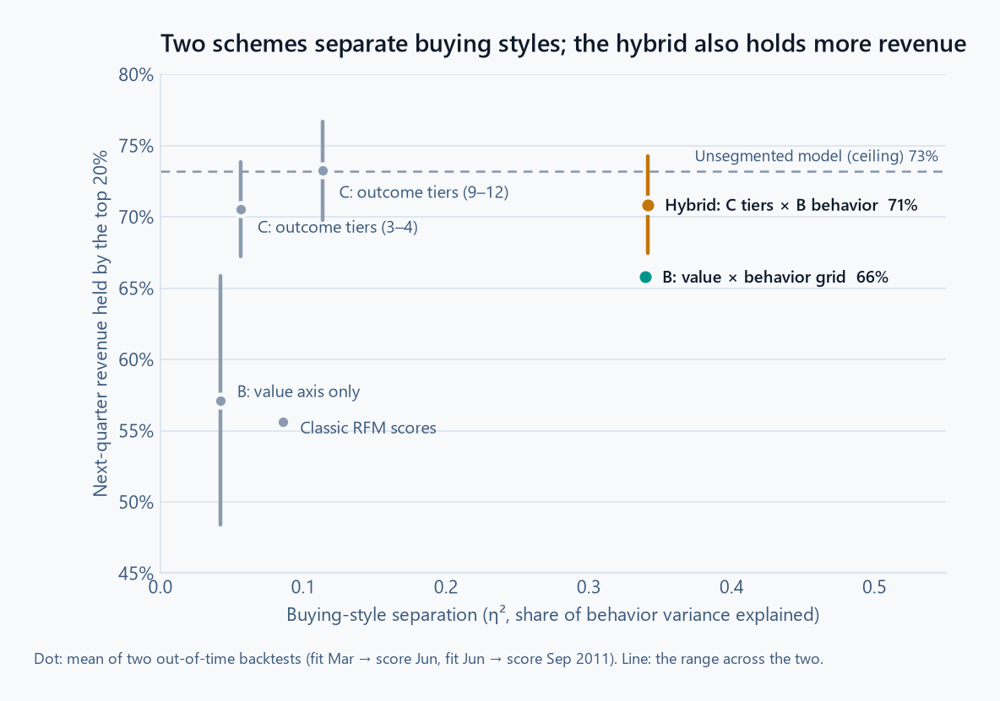
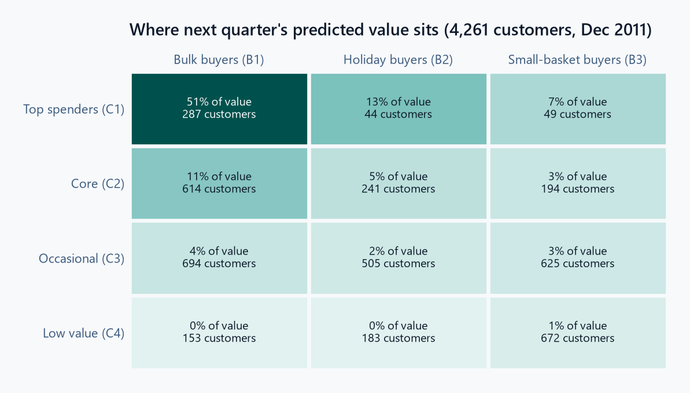
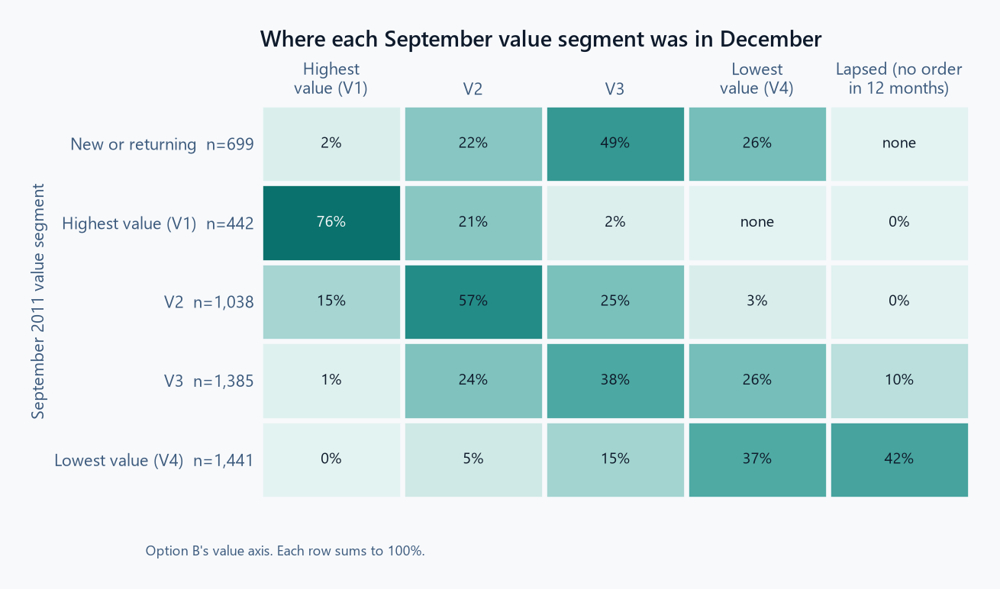
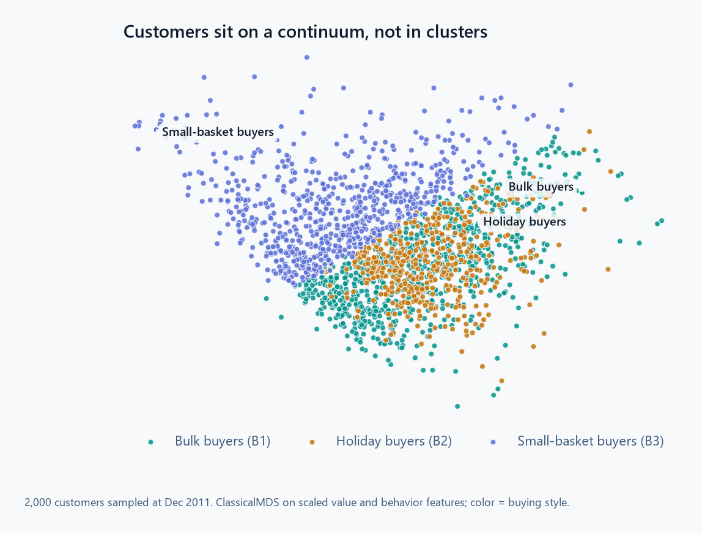
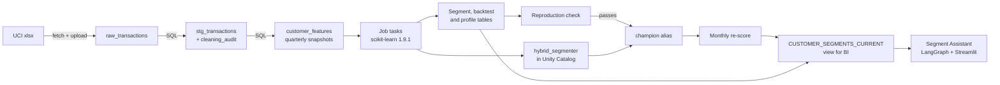

# Customer Segmentation in Snowflake

Segments 4,261 active wholesale-gift customers (UCI Online Retail II, 1.07M transactions) by **what they're worth next quarter** and **how they buy**, with every model trained and scored inside the data platform (built on Snowflake, now running on Databricks) on scikit-learn 1.9.1. Segment Assistant, an LLM chat app over the results, was tested on 1,788 questions, most of them also put to Snowflake's Cortex Analyst.

> **The Big Takeaway**
>
> Letting the AI write its own SQL made the chatbot *less* accurate. In an adversarial test, model-written SQL answered 47% of questions correctly, and most errors were real numbers attached to wrong conclusions. Moving every metric definition into tested code, so the model only chooses which calculation to run, raised accuracy to about 70% on fresh questions, with every figure traceable to the data. ([Details](docs/segment-assistant.md#why-the-model-doesnt-write-sql))

**Try it:** recorded Segment Assistant answers, each with how it was produced and how Cortex Analyst answered, are at the top of [my portfolio](https://daniel-livingston.streamlit.app). Nothing there calls a model.

**Now on Databricks.** Snowflake's trial ended, so the pipeline runs as a Databricks Asset Bundle ([databricks/](databricks/)) and the numbers below come from that build. Moving it exposed a flaw: gradient boosting's early stopping validated on a split by row, which mixed one customer's snapshots across the split and made the fitted model depend on row order. Boosting rounds now come from customer-grouped cross-validation, and shuffling the rows no longer changes anything. The backtests barely moved (hybrid top-20% capture 71.0% to 70.9%), but the line between the Occasional and Low value tiers moved from about £410–425 of trailing spend to £278. That line is close to a tie: 100 and 130 boosting rounds differ by 0.2% in cross-validated deviance and give the two different lines. The evals below were graded on the earlier numbers, kept in [practice_eval/frozen_results/](practice_eval/frozen_results/).

## Results

Most segmentation projects stop at clusters that look tidy. I wanted segments a business could act on, so every scheme is scored by what customers actually did over the next 91 days, on two out-of-time backtests:

- **Option B, two-axis clustering:** a value axis crossed with a buying-behavior axis.
- **Option C, outcome-guided segments:** gradient boosting turned into readable rules.
- **A hybrid:** C's value tiers crossed with B's behavior axis.

<picture>
  <source media="(prefers-color-scheme: dark)" srcset="docs/img/method_tradeoff-dark.png">
  
</picture>

| Scheme | Segments | Top-20% revenue capture | Buying-style separation (η²) | Buys again (AUC) |
|---|---|---|---|---|
| Classic RFM scores (baseline) | 7 | 56% | 0.09 | **0.754** |
| B: value axis only | 3–4 | 57% | 0.04 | 0.745 |
| B: value × behavior grid | 9–12 | 66% | 0.34 | 0.753 |
| C: outcome tiers | 3–4 | 71% | 0.06 | 0.716 |
| C: outcome tiers | 9–12 | **73%** | 0.11 | 0.749 |
| **Hybrid: C tiers × B behavior** | 9–12 | **71%** | **0.34** | 0.734 |
| *Unsegmented outcome model (ceiling)* | — | *73%* | — | *0.783* |

Each number is the mean of two folds: fit in March and scored in June, and fit in June and scored in September 2011 ([results/method_comparison.csv](results/method_comparison.csv)). **Top-20% revenue capture** ranks customers by their segment's historical value and measures the share of next-quarter revenue held by the top 20%. **η²** is the share of variance in the five buying-style features that segment membership explains.

One clustering over all 11 features (option A) was dropped after a 109-configuration bake-off ([exploration/](exploration/)): adding the buying-behavior features made segments *worse* at predicting next quarter, which is why B keeps value and behavior on separate axes.

## What the segments say

<picture>
  <source media="(prefers-color-scheme: dark)" srcset="docs/img/hybrid_grid-dark.png">
  
</picture>

- **The top 7% of customers, "Top spenders / Bulk buyers", hold 51% of next quarter's predicted value.** They order a median 12 times a year at 337 units per order and £1.73 per unit, which is wholesale behavior.
- **Holiday buyers are a distinct style at every value level.** 59–100% of their revenue falls in October–December. A "Top spender / Holiday buyer" needs a different calendar from a "Top spender / Bulk buyer" even though both are worth about the same.
- **Small-basket buyers pay the highest unit prices** (£2.24–2.75) with baskets of around 56–140 units. This is the most retail-like group.
- **Value tiers are sticky at the top and leaky at the bottom.** 76% of September's highest-value customers were still there in December. 42% of the lowest tier had placed no order in 12 months.

<picture>
  <source media="(prefers-color-scheme: dark)" srcset="docs/img/migration-dark.png">
  
</picture>

## Before you use them

- **There are no natural clusters.** HDBSCAN labels 61–78% of customers as noise and k-means silhouettes are 0.2–0.3, so the segments are a stable partition of a continuum, not discovered tribes.
- **Nothing much beats plain RFM at predicting who buys again.** The hybrid's AUC is 0.02 below it, and even the unsegmented model gains only 0.03. The hybrid earns its place on revenue concentration (+15 points) and buying style.
- **The hybrid's lead over the simpler grid is thin.** It captures 71% to the grid's 66%, but across the two folds the hybrid ranges from 67.5% to 74.3% and the grid from 65.7% to 65.9%. The grid uses no gradient boosting; more folds would settle it.
- **Use the £ forecasts to rank and size customers, not as a budget.** The fold that ended in the holiday quarter under-forecast revenue by 43%, because the model had never seen one.
- **Some cells are small.** Two top-spender cells hold 44 and 49 customers: key-account lists, or merge them into their value tier for broad campaigns.

<picture>
  <source media="(prefers-color-scheme: dark)" srcset="docs/img/segment_map-dark.png">
  
</picture>

All seven findings, in full, are in [docs/methodology.md](docs/methodology.md).

## Segment Assistant

A chat app over the results. A LangGraph router sends each request to one of four agents: **calculation** (figures and tables), **documentation** (answers from this project's docs, with sources), **writing** (persona cards and campaigns from a segment's profile) and **out of scope** (a fixed, polite refusal).

The first version let the model write SQL, and only 47% of 137 adversarial questions came back right, mostly real numbers attached to wrong conclusions. The rebuild moves every metric definition into tested code ([assistant/semantics.py](assistant/semantics.py)). The model only chooses a calculation and its inputs; code resolves segment names, corrects the sort direction, computes every figure and checks the answer against the rows. Every answer shows its route, plan, rows and figure check.

| Test | Questions | Result |
|---|---|---|
| Adversarial rounds 1–5, fresh questions each round | 137 to 300 a round | 47% with model-written SQL; about 70% from round 3 on |
| Practice mix against Cortex Analyst | 250 | Assistant 82.8%, Analyst 89.6% |
| Held-out retest of the fixes, graded blind | 250 | 80.0% before, 87.2% after (18 to 0, p = 8e-6) |
| Power run against Cortex Analyst | 1,400 paired | Analyst 93.8%, Assistant 87.9%: +5.9 points (95% CI 3.8–8.0, p = 4e-8) |
| Genie (Databricks) on the 175 held-out data questions | 175 | Genie 94.3%, Analyst 92.0%, Assistant 91.4%; no pair differs significantly (McNemar p = 0.42 to 1.0) |

The biggest remaining gap is questions the data can't answer, such as other countries or CRM fields, where the Assistant gives the nearest figure instead of declining. The agents, guards and every round are in [docs/segment-assistant.md](docs/segment-assistant.md); the comparison with Cortex Analyst is in [practice_eval/](practice_eval/).

It runs offline on DuckDB over the committed segment-level results with Ollama. On Databricks (`ASSISTANT_MODE=databricks`) it reads the same four tables from Unity Catalog and uses a Databricks-hosted Llama 3.3 70B; that mode was checked live on nine questions, not evaluated. The Snowflake live mode with Cortex was never tested:

```bash
pip install -r requirements-assistant.txt   # no scikit-learn needed
ollama pull qwen2.5:7b
streamlit run app.py
```

## How it works

The segmentation needs only the data platform and scikit-learn. The Segment Assistant (LangGraph, Streamlit, DuckDB and an LLM) is an optional app that reads the results; nothing in the pipeline depends on it.



**Customer data stays in the workspace.** Cleaning and features are SQL, and all fitting, scoring and evaluation run as serverless job tasks that import the [segmentation/](segmentation/) package, the same code the Snowflake build ran as stored procedures. Each production run registers its models in Unity Catalog as `challenger`; the reproduction check is the gate that moves `champion`, and the monthly re-score uses `champion`. What leaves the workspace is aggregated: [databricks/export_results.py](databricks/export_results.py) writes the segment-level tables in `results/`, [08_make_charts.py](08_make_charts.py) also reads 2,000 sampled map coordinates (no customer IDs) to draw the segment map, and the Assistant reads the four segment-level tables. The original Snowflake build is still here: steps `01`–`08`, which create and call stored procedures, and the monthly Task in [sql/](sql/).

Cleaning, features, both segmentation options, the evaluation metrics, monthly re-scoring and the scikit-learn features used are in [docs/methodology.md](docs/methodology.md).

## Reproduce

**On Databricks** (Free Edition works, but its daily compute quota is shared across projects, so avoid repeat runs):

```bash
python 01_fetch_data.py                                      # download + convert (about 1 min)
python databricks/upload_raw.py                              # schema, volumes and the raw file; no compute
cd databricks && databricks bundle deploy --profile free
databricks bundle run segmentation_pipeline --profile free   # ingest through the reproduction check and the champion gate
databricks bundle run segmentation_rescore --profile free    # optional: the monthly re-score, with the champion model
cd .. && python databricks/export_results.py                 # refresh results/*.csv
python 08_make_charts.py --from-databricks
```

The pipeline's last task compares the run with `results/` and fails on any difference outside its tolerances; only a passing run moves the `champion` alias of the registered model.

**On Snowflake** (the original build; it needs an active account). You need Python 3.11, a Snowflake account with a user that signs in with [key-pair authentication](https://docs.snowflake.com/en/user-guide/key-pair-auth), and an X-Small warehouse. The role must be able to create a database (`SYSADMIN` on a trial account works), stages, tables, views and Python procedures, and, for the optional monthly re-scoring, tasks (`EXECUTE TASK` on the account). Put the account, user, private-key path, role and warehouse in `.env` (copy it from `.env.example`).

```bash
python -m venv .venv
source .venv/bin/activate           # Windows: .venv\Scripts\activate
pip install -r requirements.txt
cp .env.example .env                # then fill it in

python 01_fetch_data.py               # download + convert (about 1 min)
python 02_load_raw.py                 # creates CUSTOMER_SEGMENTATION db, stage, RAW table
python 03_build_staging.py
python 04_build_customer_features.py
python 05_deploy_procedures.py        # zip package to stage, CREATE PROCEDURE x6
python 06_run_backtest.py             # two out-of-time folds -> ML.METHOD_COMPARISON
python 07_run_production.py           # fit Sep 2011, score Dec 2011 -> ML.CUSTOMER_SEGMENTS_CURRENT
python 08_make_charts.py             # charts in light and dark; --from-results redraws two of them without Snowflake
```

The monthly re-scoring Task is in [sql/rescore_task.sql](sql/rescore_task.sql): set its `WAREHOUSE` line and run it in a Snowsight worksheet or with `snowsql -f`. Developing the whole project, including every rerun, used under 2.5 credits.

**Tests:** 27 pipeline tests on synthetic customers with planted structure, and 140 assistant tests that check every calculation against pandas, the figure checker, and the agents with a scripted chat model. None need Ollama or Snowflake: run `pytest tests` (they also run on GitHub Actions), or `python tests/run_in_snowflake.py` to run them in Snowflake's own runtime.

## Layout

```
01–08_*.py            pipeline steps, in run order
segmentation/         code that runs inside the stored procedures
sql/                  monthly re-scoring Task
app.py                Segment Assistant UI (Streamlit)
assistant/            graph.py (LangGraph agents), semantics.py (metrics + calculations),
                      docs.py (documentation retrieval), verify.py (figure check), evaluate.py
tests/                pytest suite + Snowflake runner
practice_eval/        1,788 questions: Segment Assistant vs Cortex Analyst (practice mix, held-out, power run)
exploration/          the initial 109-configuration method bake-off
results/              exported comparison, cleaning audit, k selection, hybrid profiles
docs/                 methodology.md, segment-assistant.md, charts in img/
databricks/           Asset Bundle: the pipeline as serverless job tasks, plus the data upload and results export
```

## License and data

Code: MIT ([LICENSE](LICENSE)). Data: [Online Retail II](https://archive.ics.uci.edu/dataset/502/online+retail+ii), UCI Machine Learning Repository, CC BY 4.0.
