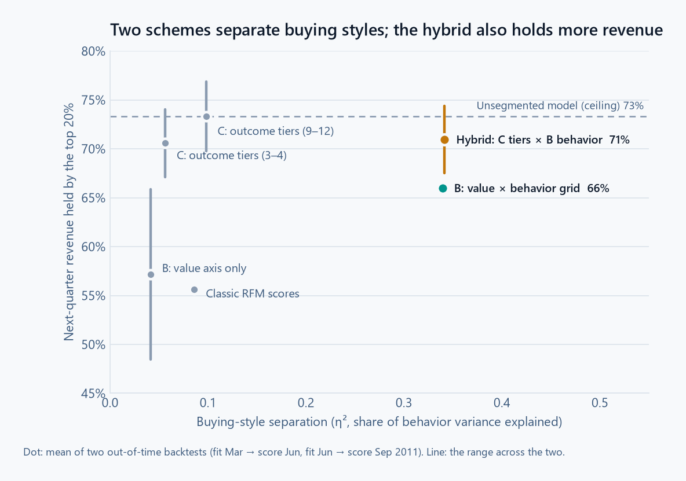
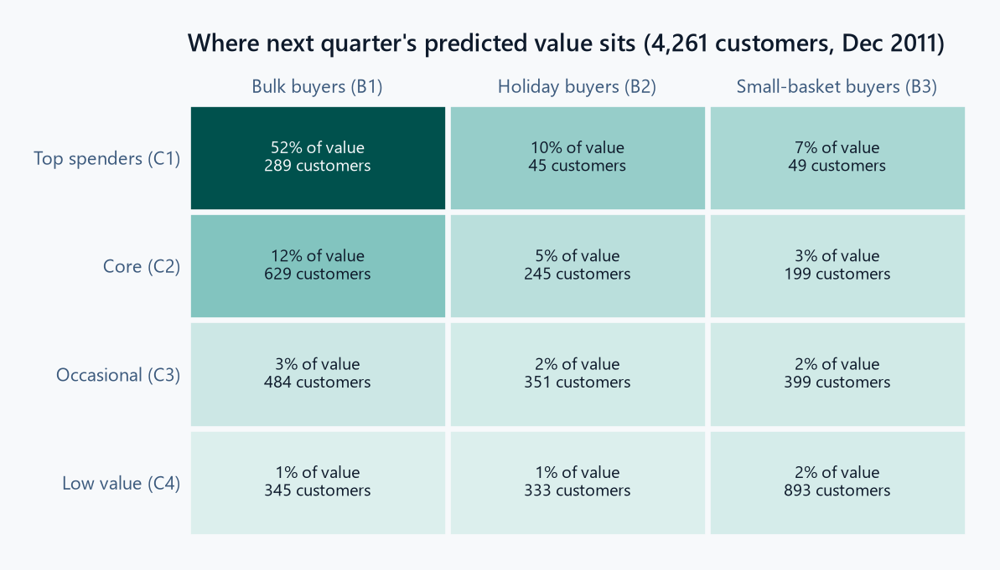
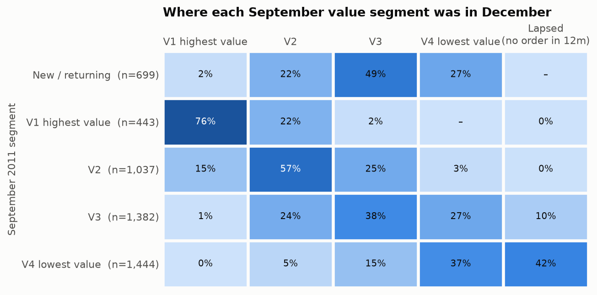
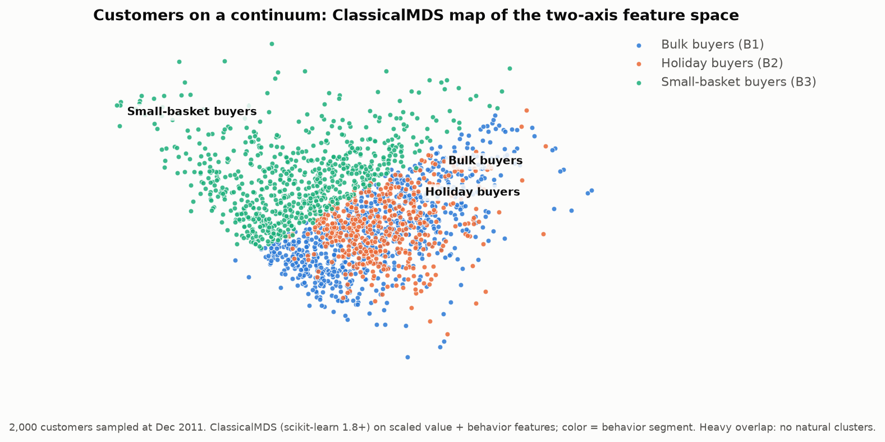

# Customer Segmentation in Snowflake

Segments 4,261 active wholesale-gift customers (UCI Online Retail II, 1.07M transactions) by **what they're worth next quarter** and **how they buy**, with every model trained and scored inside Snowflake on scikit-learn 1.9.1.

> **The Big Takeaway**
>
> Letting the AI write its own SQL made the chatbot *less* accurate. In an adversarial test, model-written SQL answered 47% of questions correctly, and most errors were real numbers attached to wrong conclusions. Moving every metric definition into tested code, so the model only chooses which calculation to run, raised accuracy to about 70% on fresh questions, with every figure traceable to the data. ([Details](#why-the-model-doesnt-write-sql))

**Why I built this.** Most segmentation projects stop at clusters that look tidy. I wanted segments a business could act on, so every scheme is scored by what customers actually did over the next quarter. It showcases the skills I bring to a senior data science role:

- in-warehouse ML on Snowflake (Snowpark stored procedures and Tasks)
- honest evaluation (out-of-time backtests against an RFM baseline)
- turning model output into business decisions
- an LLM assistant (LangGraph) checked against an evaluation set

Three approaches were compared on two out-of-time backtests, scored against what customers actually did over the next 91 days:

- **Option B, two-axis clustering:** a value axis crossed with a buying-behavior axis.
- **Option C, outcome-guided segments:** gradient boosting turned into readable rules.
- **A hybrid:** C's value tiers crossed with B's behavior axis.

Option A, one clustering over all 11 features, was dropped earlier. A 109-configuration bake-off ([exploration/](exploration/)) found that adding the buying-behavior features made segments *worse* at predicting next quarter than clustering on recency, frequency and spend alone: buys-again AUC fell from 0.752 to 0.732 and next-revenue R² from 0.28 to 0.26, for the best configuration of each. That's why B keeps value and behavior on separate axes.

Two schemes separate buying styles, and the hybrid also concentrates more next-quarter revenue. Its lead over the simpler grid is narrow (see finding 3):

<picture>
  <source media="(prefers-color-scheme: dark)" srcset="docs/img/method_tradeoff-dark.png">
  
</picture>

| Scheme | Segments | Top-20% revenue capture | Buying-style separation (η²) | Buys again (AUC) |
|---|---|---|---|---|
| Classic RFM scores (baseline) | 7 | 56% | 0.09 | **0.754** |
| B: value axis only | 3–4 | 57% | 0.04 | 0.745 |
| B: value × behavior grid | 9–12 | 66% | 0.34 | 0.753 |
| C: outcome tiers | 3–4 | 71% | 0.06 | 0.716 |
| C: outcome tiers | 9–12 | **73%** | 0.10 | 0.751 |
| **Hybrid: C tiers × B behavior** | 9–12 | **71%** | **0.34** | 0.734 |
| *Unsegmented outcome model (ceiling)* | — | *73%* | — | *0.781* |

All numbers are the mean of two folds: fit in March and scored in June, and fit in June and scored in September 2011. Per-fold numbers are in [results/method_comparison.csv](results/method_comparison.csv).

- **Top-20% revenue capture:** rank customers by their segment's historical value, then measure the share of next-quarter revenue held by the top 20%.
- **η²:** the share of variance in the five buying-style features that segment membership explains.

## What the segments say

<picture>
  <source media="(prefers-color-scheme: dark)" srcset="docs/img/hybrid_grid-dark.png">
  
</picture>

- **The top 7% of customers, "Top spenders / Bulk buyers", hold 52% of next quarter's predicted value.** They order a median 12 times a year at 337 units per order and £1.73 per unit, which is wholesale behavior.
- **Holiday buyers are a distinct style at every value level.** 59–100% of their revenue falls in October–December. A "Top spender / Holiday buyer" needs a different calendar from a "Top spender / Bulk buyer" even though both are worth about the same.
- **Small-basket buyers pay the highest unit prices** (£2.29–2.75) with baskets of around 64–140 units. This is the most retail-like group.
- **Value tiers are sticky at the top and leaky at the bottom.** 76% of September's highest-value customers were still there in December. 42% of the lowest tier had placed no order in 12 months.



## Findings worth knowing before using this

1. **There are no natural clusters.** HDBSCAN labels 61–78% of customers as noise on the full feature set, and k-means silhouettes are 0.2–0.3. The segments are a *useful, stable* partition of a continuum, chosen for predictive value and stability, not "discovered tribes". The map below shows the overlap.
2. **Nothing much beats plain RFM at predicting who buys again.** The hybrid's AUC is 0.02 below the RFM baseline, and even the unsegmented model gains only 0.03. Buying again is driven mostly by recency. The hybrid earns its place on *revenue concentration* (+15 points over RFM) and on *buying style*, not on this metric.
3. **The hybrid's lead over the simpler grid is thin.** Option B's value × behavior grid uses no gradient boosting and separates buying styles just as well (η² 0.34). It captures 66% of next-quarter revenue in its top 20%, against the hybrid's 71%. Across the two backtests the hybrid ranges from 67.5% to 74.4% and the grid from 65.9% to 66.1%, so the 5-point gain is suggestive, not established. If the outcome model's extra machinery matters, the grid is the simpler choice; more backtest folds would settle it.
4. **At 3–4 segments, C collapses to spend bands** (e.g. `net_revenue > 3598`). The model is saying that trailing 12-month spend dominates next-quarter value. The behavior axis is what adds new information.
5. **The £ forecasts are only trustworthy for seasons the model has seen.** C is trained on all past quarters pooled, with the snapshot month as a feature. The fold that ended in the holiday quarter had never seen one, and it under-forecast revenue by 44%. The rankings held up, so use `expected_revenue_next_quarter` to *rank and size* customers, not as a budget number. Adding a September 2010 snapshot, with a shorter lookback because the data starts in December 2009, would give the model one holiday quarter to learn from. That isn't done yet.
6. **Some grid cells are small.** "Top spenders / Holiday buyers" and "Top spenders / Small-basket buyers" hold 45 and 49 customers. The 5% minimum segment size is enforced per axis, not per cell. For a wholesaler, 45 top-spender holiday accounts holding about 10% of predicted value is a key-account list. For broad campaigns, merge small cells into their value tier.
7. **One selection rule was changed after seeing results.** k for each axis is chosen by the best score among stable candidates, preferring fewer segments within a tie tolerance. The tolerance was widened from 0.005 to 0.01 after production picked 7 value segments over 4 for a 0.006 R² gain, with stability just over the bar. Both backtest folds were unaffected. The full k-selection table is in [results/k_selection.csv](results/k_selection.csv).



## Segment Assistant

A chat app over the results, for the people who'd use the segments. A LangGraph router sends each request to one of four agents:

| Agent | Handles | How it answers |
|---|---|---|
| **Calculation** | *"Which segment has the most recent customers?"* · *"Crosstab of expected revenue by tier and buying style"* | The model picks one calculation and its inputs as JSON. Code computes the numbers and writes the answer. |
| **Documentation** | *"How are the forecasts made?"* · *"What does P(buys again) mean?"* | Answers from the matching README sections and cites them. |
| **Writing** | *"Write a persona card for Core / Holiday buyers"* | Writes from the segment's profile, with the checks below. |
| **Out of scope** | Coding, general knowledge, role-play | A fixed, polite refusal. |

### Why the model doesn't write SQL

The first version let the model write SQL. An adversarial test of 137 questions found only 47% answered correctly, and most errors carried real numbers attached to wrong conclusions:
- "most recent" sorted the wrong way;
- shares came out as 100% because the total was filtered with the part;
- one segment's figure was reported as a whole tier's;
- a number the user typed was trusted as fact.

Checking that each figure came from the query caught almost none of these, because the error was in the meaning, not the digits.

The rebuild moves every definition into code ([assistant/semantics.py](assistant/semantics.py)):
- **A metric catalogue** says what each measure means, which direction is "better", and how it combines: customers and predicted revenue add up, probabilities are customer-weighted, medians are never combined.
- **About a dozen tested calculations:**
  - value (including revenue per customer and combined groups), profile and share;
  - rank (within a tier or style when asked) and compare (with differences, ratios and tier-by-tier medians);
  - crosstab, threshold count and traits;
  - backtest schemes (per fold or averaged), k choice and cleaning.
- **The model only chooses** a calculation and its inputs. Code resolves names ("core holiday buyers" → C2-B2), corrects the sort direction from the question's wording, swaps in the metric the question names, reports ties, and declines anything that needs customer-level rows.

**Writing-agent guards:**
- Figures must come from the segment profile; figures the model proposes itself must be labelled "(proposed)".
- A number the user supplies that contradicts the data is dropped, with a note.
- A year-round segment described as seasonal gets flagged.
- Unknown segment names get a question back instead of a guess.
- Country targeting is declined, and injected instructions ("ignore all previous rules…") are stripped.

**Why an LLM at all?** The calculation agent is a natural-language front end to parameterised queries. A dashboard with dropdowns would answer those questions with no model, no inference cost and no risk of a wrong pick. The model earns its place where a dashboard can't help: follow-ups ("what about holiday buyers?"), explanations grounded in this README, and drafting persona cards and campaigns from the segment profiles. Its job in the calculation agent is narrow on purpose: choosing what to compute, never computing it.

Every answer shows how it was produced: the routing decision, the plan and any adjustment code made to it, the rows computed, and a figure check ([assistant/verify.py](assistant/verify.py)). Follow-ups like "what about holiday buyers?" edit the previous plan.

**Accuracy on fresh questions.** Each round, a tester agent writes new adversarial questions, checked against every earlier round's so none repeat, in formal, casual, terse and typo-laden wording. Every answer is graded against truths computed with pandas from the result CSVs:

| Round | Questions graded | Correct | On round 2's 5 categories |
|---|---|---|---|
| 1: model-written SQL | 137 | 47% | |
| 2: first semantic layer | 200 (5 categories) | 63% | 63% |
| 3: second rebuild | 200 (9 categories) | 69% | 73% |
| 4 | 150 (9 categories) | 73% | 76% |
| 5 | 300 (9 categories) | 71% | 74% |

**Accuracy has plateaued at about 70% since round 3.** Each round's fixes repair most of that round's failures when the same questions are replayed (57 of 62 after round 3, 39 of 41 after round 4, 84 of 88 after round 5), but new questions keep finding new gaps. More wording rules are giving diminishing returns. The next thing to try is a larger model (`qwen2.5:14b` locally, or Cortex), which hasn't been tested yet.

Round 5 by category:

| Category | Correct |
|---|---|
| Comparisons | 93% |
| Crosstabs | 87% |
| Backtest, k and cleaning | 76% |
| Declines and injection | 76% |
| Methodology and advice | 72% |
| Rankings | 69% |
| Lookups and totals | 65% |
| Follow-ups | 63% |
| Writing | 50% |

No answer in round 5 was unsafe. The most common failure is an unhelpful answer (wrong format, partial, or a unit ignored) at 12% of questions, then a wrong claim or direction (8%) and a wrong number (6%).

**Fixes after round 5:**
- **The question's wording beats the plan:** several exclusions ("except C4-B3 and C1-B1"), "every segment" meaning all of them, a filter's measure kept apart from the measure being totalled ("expected revenue from segments whose P(buys again) is above 50%"), "share of X that are Y" divided by X, "how many" vs "what proportion" in every calculation, ordinals ("second smallest") and per-segment averages.
- **Rankings:** groups narrowed to one segment each are ranked and labelled as segments; tiers and styles on a median are shown as the range of their segments instead of an error.
- **Writing agent:** wording the data contradicts (lapsed, seasonal, bulk, infrequent, a "December spike") is rewritten, and if it survives two rewrites it is removed rather than noted; £ and % offers are marked "(proposed)"; SMS, tweets and notes are stripped of headings, greetings, persona cards, codes and internal segment names.
- **Units and declines:** pence, thousands, millions and a no-exchange-rate note; SQL, "which customer" and "which country" requests are declined.

Still open from round 5: a terse "why?" follow-up that misstates the k rule, a "2-sentence idea" that reads recency as frequency, and two campaigns that the clean-up leaves thin (no offer or an empty body).

**Regression check.** [assistant/evaluate.py](assistant/evaluate.py) re-asks 67 questions from development and earlier rounds, scoring words ("No", "lower") as well as figures against pandas. On the last full run with `qwen2.5:7b`:

| Set | Correct |
|---|---|
| Tuning (21) | 21 (100%) |
| Held out (11) | 11 (100%) |
| Earlier red-team failures (20) | 20 (100%) |
| Round 5 failures (15) | 15 (100%) |

Every figure in every answer traced back to the data. Most of these questions were tuned against, so 100% means past fixes still hold, not that new questions will be answered correctly; the rounds above measure that. Results are in `results/assistant_eval.csv`; rerun with `python -m assistant.evaluate`.

| | Offline (default) | Live |
|---|---|---|
| Data | DuckDB over `results/*.csv` (aggregated, committed) | The same tables from the `ML` schema in Snowflake |
| LLM | Ollama, `qwen2.5:7b` | Snowflake Cortex, `llama3.1-70b` |
| Needs | [Ollama](https://ollama.com) | `.env` with Snowflake credentials |

Offline mode exists so anyone can try the app without a Snowflake account. It reads the segment-level result tables exported to `results/` (no customer rows), and DuckDB runs the same fixed queries over them. Live mode is untested. The calculations work on segment-level tables, so customer-level questions are declined in both modes.

```bash
pip install -r requirements-assistant.txt   # no scikit-learn needed
ollama pull qwen2.5:7b
streamlit run app.py
```

`ASSISTANT_MODE` (`auto`/`local`/`live`), `ASSISTANT_LLM` (`auto`/`ollama`/`cortex`), `OLLAMA_MODEL`, `CORTEX_MODEL` and `LLM_TIMEOUT` override the defaults. The app only runs fixed, read-only queries, and offline DuckDB has file and network access switched off. In live mode, also run the app under a read-only role.

## How it works

The segmentation needs only Snowflake and scikit-learn. The Segment Assistant (LangGraph, Streamlit, DuckDB and an LLM) is an optional app that reads the results; nothing in the pipeline depends on it.


**Customer data never leaves Snowflake.** Steps 01–04 are SQL. All fitting, scoring and evaluation runs in permanent Python stored procedures, created by [05_deploy_procedures.py](05_deploy_procedures.py) from the [segmentation/](segmentation/) package zipped on a stage. The local machine only issues `CALL` statements. The exceptions are [08_make_charts.py](08_make_charts.py), which reads *aggregated* result tables to draw the charts above, and the assistant in live mode, which returns query results (at most 200 rows) to the app.

### Data and cleaning ([03_build_staging.py](03_build_staging.py))

| Step | Rows | Change |
|---|---|---|
| Raw (both Excel sheets) | 1,067,371 | |
| Remove sheet overlap | 1,044,848 | −22,523 |
| Remove exact duplicates | 1,033,036 | −11,812 |
| Remove stock write-offs (zero/negative-price non-returns) | 1,026,999 | −6,037 |
| Product lines with a customer ID | 794,165 | |

**The two published sheets overlap.** The 2009–10 sheet repeats the first nine days of December 2010 from the 2010–11 sheet, and concatenating them naively double-counts that month. Non-product lines (postage, Amazon fees, manual adjustments, vouchers, test items) are flagged and kept out of customer features.

### Features ([04_build_customer_features.py](04_build_customer_features.py))

There is one row per customer per quarterly snapshot (Dec 2010 → Dec 2011):
- 15 behavior features over a 365-day lookback
- outcomes over the next 91 days: whether the customer buys again, and their net revenue

Only data before the snapshot date feeds the features. The last snapshot (2011-12-10) has no outcomes; it's "today".

### Option B: two-axis ([segmentation/two_axis.py](segmentation/two_axis.py))

- **Value axis** (recency, orders, net revenue) and **behavior axis** (units per order, unit price, lines per order, return rate, Q4 revenue share).
- Each axis is a `Pipeline` of log1p → scale → clip ±3 SD → `BisectingKMeans(bisecting_strategy="largest_cluster")`. That strategy keeps splitting the largest group instead of carving out tiny outlier segments.
- **k is chosen per axis.** The value axis uses out-of-fold R² for next-quarter revenue; the behavior axis uses silhouette. Both require bootstrap stability (ARI ≥ 0.85 on 80% subsamples) and every segment holding ≥ 5% of customers.
- **Surrogate decision trees produce plain-English assignment rules.** They reproduce the actual segments 81–88% of the time (cross-validated).

### Option C: outcome-guided ([segmentation/outcome_guided.py](segmentation/outcome_guided.py))

- **P(buys again):** `HistGradientBoostingClassifier`, calibrated with `CalibratedClassifierCV(FrozenEstimator(booster), method="temperature")` on a held-out, customer-grouped split.
- **Expected revenue:** `HistGradientBoostingRegressor(loss="poisson")`. Most customers spend £0 next quarter, and spend is non-negative and right-skewed.
- **Segments:** a shallow regression tree trained on the readable features to reproduce the *out-of-fold* expected revenue. Each leaf is a segment, and its path is the rule.
- **Training data:** pooled over every past snapshot, with `GroupKFold` / `GroupShuffleSplit` by customer, because the same customer appears in several quarters.

### Evaluation ([segmentation/evaluation.py](segmentation/evaluation.py))

Every scheme is fit on one snapshot. Its segments' outcome rates are learned from that snapshot's outcomes, then applied to customers' segments at the *next* snapshot and scored against what actually happened. Metrics:
- buys-again AUC
- Spearman correlation with next-quarter revenue
- top-20% revenue capture, with tied segments sharing the cut-off proportionally
- η² for value and behavior features
- rule fidelity
- segment persistence quarter to quarter
- a forecast-bias check that rank metrics miss

### Monthly re-scoring ([sql/rescore_task.sql](sql/rescore_task.sql))

The `RESCORE_SEGMENTS_MONTHLY` Task calls `ML.RESCORE_CUSTOMERS` on the 1st of each month. It:
1. rebuilds `MARTS.CUSTOMER_FEATURES` for the snapshot after the latest transaction (the same SQL as step 04, from [segmentation/feature_sql.py](segmentation/feature_sql.py))
2. scores it with the frozen production models from `@ML.MODELS`
3. writes hybrid rows under `run_id = 'rescore'`, which `CUSTOMER_SEGMENTS_CURRENT` prefers over the production run for the same snapshot

The dataset is static, so every run re-derives 2011-12-10. The procedure reports how many customers got the same segment as the production run; all of them should.

**Why not the Snowflake Model Registry?** A custom registry model needs `snowflake-ml-python` in its runtime, and every build of it in Snowflake's Anaconda channel (up to 1.51.0) requires `scikit-learn<1.9`. The models need 1.9.1. Until the channel catches up, the models stay as versioned joblib files on a stage, one folder per run.

## scikit-learn: what's used and why

The code is pinned to **1.9.1, the latest stable release**, which is also in Snowflake's Anaconda channel, so local and in-warehouse code run identical versions.

| Feature | Since | Used for |
|---|---|---|
| `manifold.ClassicalMDS` | 1.8 | The segment map |
| `CalibratedClassifierCV(method="temperature")` | 1.8 | Calibrating P(buys again) |
| `frozen.FrozenEstimator` | 1.6 | Calibrating without refitting the booster on calibration data |
| `cluster.HDBSCAN` | 1.3 | Evidence that there are no natural clusters ([exploration/](exploration/)) |
| `set_output(transform="pandas")` | 1.2 | Named columns through every preprocessing step |
| `cluster.BisectingKMeans` | 1.1 | Both axes of option B |

The experimental callbacks API (new in 1.9) isn't used: none of the clustering or gradient-boosting estimators support it yet.

**On Windows, Smart App Control may block scikit-learn 1.9.1.** On some machines it refuses to load one of the wheel's DLLs (`_libsvm_sparse`). The pipeline itself isn't affected because it runs in Snowflake. To run the tests there, use GitHub Actions or `python tests/run_in_snowflake.py`. The assistant doesn't use scikit-learn.

## Reproduce

**You need:**
- Python 3.11.
- A Snowflake account with a user that signs in with [key-pair authentication](https://docs.snowflake.com/en/user-guide/key-pair-auth).
- **A role that can:**
  - create a database (step 02 creates `CUSTOMER_SEGMENTATION` with `RAW`, `STAGING`, `MARTS` and `ML` schemas, so `SYSADMIN` on a trial account works);
  - create stages, tables, views and Python procedures in it;
  - create and run tasks: `EXECUTE TASK` on the account, for the optional monthly re-scoring.
- An X-Small warehouse that role can use.

Put the account, user, private-key path, role and warehouse in `.env` (copy it from `.env.example`).

```bash
python -m venv .venv
source .venv/bin/activate           # Windows: .venv\Scripts\activate
pip install -r requirements.txt
cp .env.example .env                # then fill it in

python 01_fetch_data.py               # download + convert (about 1 min)
python 02_load_raw.py                 # creates CUSTOMER_SEGMENTATION db, stage, RAW table
python 03_build_staging.py
python 04_build_customer_features.py
python 05_deploy_procedures.py        # zip package to stage, CREATE PROCEDURE x6
python 06_run_backtest.py             # two out-of-time folds -> ML.METHOD_COMPARISON
python 07_run_production.py           # fit Sep 2011, score Dec 2011 -> ML.CUSTOMER_SEGMENTS_CURRENT
python 08_make_charts.py             # charts in light and dark; --from-results redraws two of them without Snowflake
```

Then, optionally, create the monthly re-scoring Task. Run [sql/rescore_task.sql](sql/rescore_task.sql) in a Snowsight SQL worksheet or with SnowSQL (`snowsql -f sql/rescore_task.sql`), after setting its `WAREHOUSE` line to your warehouse. If you deployed before re-scoring existed, run `python 05_deploy_procedures.py` and `python 07_run_production.py --view-only`; the second recreates the view without retraining.

Everything runs on an X-Small warehouse. Developing the whole project, including every rerun, used under 2.5 credits.

**Tests:** 27 pipeline tests on synthetic customers with planted structure. They check that the methods recover it, that segment codes are ordered by meaning, that every generated rule is true for the customers it describes, that re-scoring builds the same cells as the hybrid, and the metric edge cases. 118 assistant tests:
- every calculation, checked against pandas on the cases the SQL version got wrong;
- the figure checker;
- the agents with a scripted chat model: plan repair, direction and metric corrections, declines, follow-ups, documentation answers, the writing guards;
- a headless run of the app.

None need Ollama or Snowflake. They run on GitHub Actions (`pytest tests`), or inside Snowflake's own runtime with `python tests/run_in_snowflake.py`.

## Layout

```
01–08_*.py            pipeline steps, in run order
segmentation/         code that runs inside the stored procedures
sql/                  monthly re-scoring Task
app.py                Segment Assistant UI (Streamlit)
assistant/              graph.py (LangGraph agents), semantics.py (metrics + calculations),
                      docs.py (README retrieval), verify.py (figure check), evaluate.py
tests/                pytest suite + Snowflake runner
exploration/          the initial 109-configuration method bake-off
results/              exported comparison, cleaning audit, k selection, hybrid profiles
docs/img/             charts
```

Data: [Online Retail II](https://archive.ics.uci.edu/dataset/502/online+retail+ii), UCI Machine Learning Repository, CC BY 4.0.
