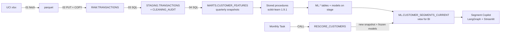

# Customer Segmentation in Snowflake

Segments 4,261 active wholesale-gift customers (UCI Online Retail II, 1.07M transactions) by **what they're worth next quarter** and **how they buy**, with every model trained and scored inside Snowflake on scikit-learn 1.9.1.

Three approaches were compared on two out-of-time backtests, scored against what customers actually did over the next 91 days:

- **Option B, two-axis clustering:** a value axis crossed with a buying-behavior axis.
- **Option C, outcome-guided segments:** gradient boosting turned into readable rules.
- **A hybrid:** C's value tiers crossed with B's behavior axis.

The hybrid is the only approach that does both jobs:


| Scheme | Segments | Top-20% revenue capture | Buying-style separation (η²) | Buys again (AUC) |
|---|---|---|---|---|
| Classic RFM scores (baseline) | 7 | 56% | 0.09 | **0.754** |
| B: value axis only | 3–4 | 57% | 0.04 | 0.745 |
| B: value × behavior grid | 9–12 | 66% | 0.34 | 0.753 |
| C: outcome tiers | 3–4 | 71% | 0.06 | 0.716 |
| C: outcome tiers | 9–12 | **73%** | 0.10 | 0.751 |
| **Hybrid: C tiers × B behavior** | 9–12 | **71%** | **0.34** | 0.734 |
| *Unsegmented outcome model (ceiling)* | — | *73%* | — | *0.781* |

All numbers are the mean of two folds: fit in March and scored in June, and fit in June and scored in September 2011. Per-fold numbers are in [results/method_comparison.csv](results/method_comparison.csv).

- **Top-20% revenue capture:** rank customers by their segment's historical value, then measure the share of next-quarter revenue held by the top 20%.
- **η²:** the share of variance in the five buying-style features that segment membership explains.

## What the segments say


- **The top 7% of customers, "Top spenders / Bulk buyers", hold 52% of next quarter's predicted value.** They order a median 12 times a year at 337 units per order and £1.73 per unit, which is wholesale behavior.
- **Holiday buyers are a distinct style at every value level.** 59–100% of their revenue falls in October–December. A "Top spender / Holiday buyer" needs a different calendar from a "Top spender / Bulk buyer" even though both are worth about the same.
- **Small-basket buyers pay the highest unit prices** (£2.29–2.75) with baskets of around 64–140 units. This is the most retail-like group.
- **Value tiers are sticky at the top and leaky at the bottom.** 76% of September's highest-value customers were still there in December. 42% of the lowest tier had placed no order in 12 months.


## Findings worth knowing before using this

1. **There are no natural clusters.** HDBSCAN labels 61–78% of customers as noise on the full feature set, and k-means silhouettes are 0.2–0.3. The segments are a *useful, stable* partition of a continuum, chosen for predictive value and stability, not "discovered tribes". The map below shows the overlap.
2. **Nothing much beats plain RFM at predicting who buys again.** The hybrid's AUC is 0.02 below the RFM baseline, and even the unsegmented model gains only 0.03. Buying again is driven mostly by recency. The hybrid earns its place on *revenue concentration* (+15 points over RFM) and on *buying style*, not on this metric.
3. **At 3–4 segments, C collapses to spend bands** (e.g. `net_revenue > 3598`). The model is saying that trailing 12-month spend dominates next-quarter value. The behavior axis is what adds new information.
4. **The £ forecasts are only trustworthy for seasons the model has seen.** C is trained on all past quarters pooled, with the snapshot month as a feature. The fold that ended in the holiday quarter had never seen one, and it under-forecast revenue by 44%. The rankings held up, so use `expected_revenue_next_quarter` to *rank and size* customers, not as a budget number.
5. **Some grid cells are small.** "Top spenders / Holiday buyers" and "Top spenders / Small-basket buyers" hold 45 and 49 customers. The 5% minimum segment size is enforced per axis, not per cell.
6. **One selection rule was changed after seeing results.** k for each axis is chosen by the best score among stable candidates, preferring fewer segments within a tie tolerance. The tolerance was widened from 0.005 to 0.01 after production picked 7 value segments over 4 for a 0.006 R² gain, with stability just over the bar. Both backtest folds were unaffected. The full k-selection table is in [results/k_selection.csv](results/k_selection.csv).


## Segment Copilot

A chat app over the results, for the people who'd use the segments. A LangGraph router sends each request to one of two agents:

- **Analytical agent:** writes SQL against the segment tables, runs it, repairs it once if it fails, and answers from the rows. *"Which segment holds the most expected revenue next quarter?"*
- **Generative agent:** retrieves the statistics of the segments you name and writes persona cards or campaigns grounded in them. *"Draft a win-back email for Low value / Bulk buyers."*

Each answer shows how it was produced: the routing decision, every SQL attempt (including failed ones and the error), the rows returned, and the segment statistics the generative agent was given. Follow-ups like "now draft an email for that segment" work because conversation state is kept per session.

| | Offline (default) | Live |
|---|---|---|
| Data | DuckDB over `results/*.csv` (aggregated, committed) | Snowflake temporary views over the `ML` schema, plus customer-level `CUSTOMERS` and `MIGRATION` |
| LLM | Ollama, `qwen2.5:7b` | Snowflake Cortex, `llama3.1-70b` |
| Needs | [Ollama](https://ollama.com) | `.env` with Snowflake credentials |

```bash
pip install -r requirements-copilot.txt   # no scikit-learn needed
ollama pull qwen2.5:7b
streamlit run app.py
```

`COPILOT_MODE` (`auto`/`local`/`live`), `COPILOT_LLM` (`auto`/`ollama`/`cortex`), `OLLAMA_MODEL` and `CORTEX_MODEL` override the defaults. Generated SQL is limited to one read-only `SELECT`, and offline DuckDB has file and network access switched off. In live mode, also run the app under a read-only role.

## How it works



**Customer data never leaves Snowflake.** Steps 01–04 are SQL. All fitting, scoring and evaluation runs in permanent Python stored procedures, created by [05_deploy_procedures.py](05_deploy_procedures.py) from the [segmentation/](segmentation/) package zipped on a stage. The local machine only issues `CALL` statements. The exceptions are [08_make_charts.py](08_make_charts.py), which reads *aggregated* result tables to draw the charts above, and the copilot in live mode, which returns query results (at most 200 rows) to the app.

### Data and cleaning ([03_build_staging.py](03_build_staging.py))

| Step | Rows | Change |
|---|---|---|
| Raw (both Excel sheets) | 1,067,371 | |
| Remove sheet overlap | 1,044,848 | −22,523 |
| Remove exact duplicates | 1,033,036 | −11,812 |
| Remove stock write-offs (zero/negative-price non-returns) | 1,026,999 | −6,037 |
| Product lines with a customer ID | 794,165 | |

**The two published sheets overlap.** The 2009–10 sheet repeats the first nine days of December 2010 from the 2010–11 sheet, and concatenating them naively double-counts that month. Non-product lines (postage, Amazon fees, manual adjustments, vouchers, test items) are flagged and kept out of customer features.

### Features ([04_build_customer_features.py](04_build_customer_features.py))

There is one row per customer per quarterly snapshot (Dec 2010 → Dec 2011):
- 15 behavior features over a 365-day lookback
- outcomes over the next 91 days: whether the customer buys again, and their net revenue

Only data before the snapshot date feeds the features. The last snapshot (2011-12-10) has no outcomes; it's "today".

### Option B: two-axis ([segmentation/two_axis.py](segmentation/two_axis.py))

- **Value axis** (recency, orders, net revenue) and **behavior axis** (units per order, unit price, lines per order, return rate, Q4 revenue share).
- Each axis is a `Pipeline` of log1p → scale → clip ±3 SD → `BisectingKMeans(bisecting_strategy="largest_cluster")`. That strategy keeps splitting the largest group instead of carving out tiny outlier segments.
- **k is chosen per axis.** The value axis uses out-of-fold R² for next-quarter revenue; the behavior axis uses silhouette. Both require bootstrap stability (ARI ≥ 0.85 on 80% subsamples) and every segment holding ≥ 5% of customers.
- **Surrogate decision trees produce plain-English assignment rules.** They reproduce the actual segments 81–88% of the time (cross-validated).

### Option C: outcome-guided ([segmentation/outcome_guided.py](segmentation/outcome_guided.py))

- **P(buys again):** `HistGradientBoostingClassifier`, calibrated with `CalibratedClassifierCV(FrozenEstimator(booster), method="temperature")` on a held-out, customer-grouped split.
- **Expected revenue:** `HistGradientBoostingRegressor(loss="poisson")`. Most customers spend £0 next quarter, and spend is non-negative and right-skewed.
- **Segments:** a shallow regression tree trained on the readable features to reproduce the *out-of-fold* expected revenue. Each leaf is a segment, and its path is the rule.
- **Training data:** pooled over every past snapshot, with `GroupKFold` / `GroupShuffleSplit` by customer, because the same customer appears in several quarters.

### Evaluation ([segmentation/evaluation.py](segmentation/evaluation.py))

Every scheme is fit on one snapshot. Its segments' outcome rates are learned from that snapshot's outcomes, then applied to customers' segments at the *next* snapshot and scored against what actually happened. Metrics:
- buys-again AUC
- Spearman correlation with next-quarter revenue
- top-20% revenue capture, with tied segments sharing the cut-off proportionally
- η² for value and behavior features
- rule fidelity
- segment persistence quarter to quarter
- a forecast-bias check that rank metrics miss

### Monthly re-scoring ([sql/rescore_task.sql](sql/rescore_task.sql))

The `RESCORE_SEGMENTS_MONTHLY` Task calls `ML.RESCORE_CUSTOMERS` on the 1st of each month. It:
1. rebuilds `MARTS.CUSTOMER_FEATURES` for the snapshot after the latest transaction (the same SQL as step 04, from [segmentation/feature_sql.py](segmentation/feature_sql.py))
2. scores it with the frozen production models from `@ML.MODELS`
3. writes hybrid rows under `run_id = 'rescore'`, which `CUSTOMER_SEGMENTS_CURRENT` prefers over the production run for the same snapshot

The dataset is static, so every run re-derives 2011-12-10. The procedure reports how many customers got the same segment as the production run; all of them should.

**Why not the Snowflake Model Registry?** A custom registry model needs `snowflake-ml-python` in its runtime, and every build of it in Snowflake's Anaconda channel (up to 1.51.0) requires `scikit-learn<1.9`. The models need 1.9.1. Until the channel catches up, the models stay as versioned joblib files on a stage, one folder per run.

## scikit-learn: what's used and why

The code is pinned to **1.9.1, the latest stable release**, which is also in Snowflake's Anaconda channel, so local and in-warehouse code run identical versions.

| Feature | Since | Used for |
|---|---|---|
| `manifold.ClassicalMDS` | 1.8 | The segment map |
| `CalibratedClassifierCV(method="temperature")` | 1.8 | Calibrating P(buys again) |
| `frozen.FrozenEstimator` | 1.6 | Calibrating without refitting the booster on calibration data |
| `cluster.HDBSCAN` | 1.3 | Evidence that there are no natural clusters ([exploration/](exploration/)) |
| `set_output(transform="pandas")` | 1.2 | Named columns through every preprocessing step |
| `cluster.BisectingKMeans` | 1.1 | Both axes of option B |

The experimental callbacks API (new in 1.9) isn't used: none of the clustering or gradient-boosting estimators support it yet.

**On Windows, Smart App Control may block scikit-learn 1.9.1.** On some machines it refuses to load one of the wheel's DLLs (`_libsvm_sparse`). The pipeline itself isn't affected because it runs in Snowflake. To run the tests there, use GitHub Actions or `python tests/run_in_snowflake.py`. The copilot doesn't use scikit-learn.

## Reproduce

Requires a Snowflake account with key-pair auth and Python 3.11.

```bash
python -m venv .venv && .venv/Scripts/activate      # or source .venv/bin/activate
pip install -r requirements.txt
cp .env.example .env                                 # fill in account, user, key path, role, warehouse

python 01_fetch_data.py               # download + convert (about 1 min)
python 02_load_raw.py                 # creates CUSTOMER_SEGMENTATION db, stage, RAW table
python 03_build_staging.py
python 04_build_customer_features.py
python 05_deploy_procedures.py        # zip package to stage, CREATE PROCEDURE x6
python 06_run_backtest.py             # two out-of-time folds -> ML.METHOD_COMPARISON
python 07_run_production.py           # fit Sep 2011, score Dec 2011 -> ML.CUSTOMER_SEGMENTS_CURRENT
python 08_make_charts.py
```

Then create the monthly re-scoring Task by running [sql/rescore_task.sql](sql/rescore_task.sql) in a worksheet (set its warehouse first). If you deployed before re-scoring existed, run `python 05_deploy_procedures.py` and `python 07_run_production.py --view-only`; the second recreates the view without retraining.

Everything runs on an X-Small warehouse. Developing the whole project, including every rerun, used under 2.5 credits.

**Tests:** 27 pipeline tests on synthetic customers with planted structure. They check that the methods recover it, that segment codes are ordered by meaning, that every generated rule is true for the customers it describes, that re-scoring builds the same cells as the hybrid, and the metric edge cases. 18 copilot tests use a scripted chat model to cover routing, SQL repair, segment retrieval, follow-ups, the SQL guard rails and a headless run of the app. They run on GitHub Actions (`pytest tests`), or inside Snowflake's own runtime with `python tests/run_in_snowflake.py`.

## Layout

```
01–08_*.py            pipeline steps, in run order
segmentation/         code that runs inside the stored procedures
sql/                  monthly re-scoring Task
app.py, copilot/      Segment Copilot (Streamlit + LangGraph)
tests/                pytest suite + Snowflake runner
exploration/          the initial 109-configuration method bake-off
results/              exported comparison, cleaning audit, k selection, hybrid profiles
docs/img/             charts
```

Data: [Online Retail II](https://archive.ics.uci.edu/dataset/502/online+retail+ii), UCI Machine Learning Repository, CC BY 4.0.
